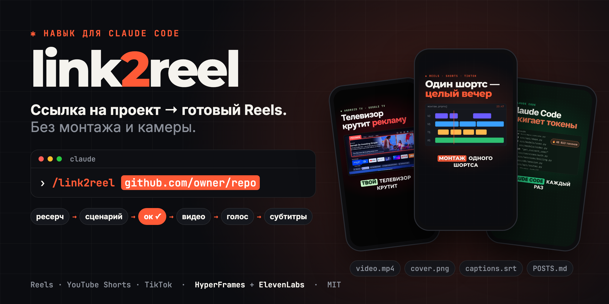

<p align="center"></p>

# /link2reel — вертикальные ролики о проектах силами Claude Code

Даёшь ссылку на GitHub-репозиторий, сайт или название инструмента — Claude Code сам изучает проект, пишет сценарий с цепляющим хуком, собирает ролик 9:16 в стиле проекта, озвучивает его, ставит субтитры и готовит тексты постов для YouTube Shorts, Instagram Reels и TikTok.

```
/link2reel https://github.com/owner/repo
```

Ролик собирается из кода ([HyperFrames](https://github.com/heygen-com/hyperframes): HTML → MP4), поэтому камера и монтажёр не нужны. Озвучка — [ElevenLabs](https://elevenlabs.io). Язык роликов по умолчанию — русский.

---

## Что получаешь

```
~/Movies/shorts/2026-10-23-<проект>/
├── research/RESEARCH.md   факты о проекте — каждый со ссылкой на источник
├── SCRIPT.md              3 хука с оценкой, сценарий по сценам
└── deliver/
    ├── video.mp4          1080×1920, 30–40 с, озвучка + субтитры
    ├── cover.png          обложка (первый кадр с хуком)
    ├── captions.srt       субтитры для YouTube Studio
    └── POSTS.md           заголовок и описание YouTube, подписи Reels и TikTok, хэштеги
```

## Как это работает

1. **Ресерч** — README, GitHub API, сайт, обзоры, Hacker News, Threads. Факт без источника в ролик не попадает.
2. **Стиль под проект** — цвета, шрифт (с кириллицей), логотип и настоящие скриншоты проекта.
3. **Сценарий** — 3 хука «через боль» с оценкой из 10, надпись для обложки, повторный крючок в середине, проверки качества и вычитка от «ИИ-шного» текста.
   **⏸ Остановка: Claude показывает бриф, хуки и сценарий и ждёт твоего «ок».**
4. **Черновое видео** на бесплатном голосе — смотришь картинку, не тратя символы ElevenLabs.
   **⏸ Остановка: «озвучивай» — и только тогда тратятся символы.**
5. **Озвучка** твоим голосом ElevenLabs. Анимации, субтитры и звуки привязаны к словам и подстраиваются под голос сами.
6. **Проверка и рендер** — проверка композиции, просмотр кадров, рендер, замер громкости, пакет для публикации.

Флаги: `--auto` — без остановок; `--like <ролик.mp4 или ссылка>` — подстроить ритм под вирусный ролик-образец.

---

## Установка

### 1. Программы

Нужны Node.js 22+, FFmpeg, Python 3.10+. На macOS:

```bash
brew install node ffmpeg python gh
```

`gh` (GitHub CLI) нужен для ресерча репозиториев: после установки выполни `gh auth login`.

### 2. Навык и его зависимости

```bash
npx skills add ilyaki3/link2reel -g -a claude-code       # сам навык /link2reel
npx hyperframes skills update                              # движок видео HyperFrames
npx skills add ilyautov/humanizer-ru -g -a claude-code     # вычитка русского текста
python3 -m pip install --user pymorphy3==2.0.6 razdel==0.5.0   # сканер для humanizer-ru
```

Или вручную: `git clone https://github.com/ilyaki3/link2reel ~/.claude/skills/link2reel`.

### 3. ElevenLabs: ключ

1. Зарегистрируйся на [elevenlabs.io](https://elevenlabs.io).
2. Профиль → **API Keys** → **Create API Key**. Включи права:
   **Text to Speech** · **Voices: Read + Write** · **Models: Read** · **User: Read**.
3. Сохрани ключ в окружение — команда спросит ключ и не покажет его на экране (не вставляй ключ в чат):
   ```bash
   read -s "K?ElevenLabs API key: " && echo "export ELEVENLABS_API_KEY=\"$K\"" >> ~/.zshrc && unset K && source ~/.zshrc
   ```

### 4. ElevenLabs: голос

На **бесплатном** тарифе (10 000 символов в месяц ≈ 13–15 роликов) через API работают только встроенные голоса и голоса, созданные тобой. Голоса из общей библиотеки — только на платном тарифе.

Лучший бесплатный путь — **создать свой голос**: Voices → Create a Voice → **Voice Design**. Пример описания:

```
Deep Russian male baritone, middle-aged, native Moscow accent. Confident, premium, slightly authoritative tone, like a luxury commercial or movie trailer narrator. Rich low chest resonance, smooth and velvety. Studio-quality close-mic recording, no background noise. Energetic but not rushed, crisp diction.
```

Затем выбери голос для навыка:

```bash
python3 ~/.claude/skills/link2reel/tools/voices.py              # список твоих голосов с id
python3 ~/.claude/skills/link2reel/tools/voices.py <voice_id>   # записать в channel.json
```

### 5. Проверка

```bash
bash ~/.claude/skills/link2reel/tools/doctor.sh
```

Проверяет программы, навыки, ключ, голос и остаток символов. Под каждым ✗ — команда для исправления. Правило про тире для humanizer-ru (тире в озвучке — это паузы голоса) добавляется так:

```bash
bash ~/.claude/skills/link2reel/tools/doctor.sh --fix-dash-rule
```

### 6. (Необязательно) Бесплатный черновой голос

Черновик видео собирается на Edge TTS, чтобы не тратить символы ElevenLabs:

```bash
python3 -m venv ~/.short-venv && ~/.short-venv/bin/pip install edge-tts
```

Claude вызовет его сам: `voice.py <проект> --provider edge --python ~/.short-venv/bin/python`.

---

## Использование

Открой Claude Code в любой папке и напиши:

```
/link2reel https://github.com/Graphify-Labs/graphify
```

Дальше:
1. Claude присылает бриф, 3 хука и сценарий → ответь «берём A» или напиши правки.
2. Присылает черновое видео → «озвучивай» или правки по картинке.
3. Присылает готовый ролик, обложку и тексты постов.

Примеры запросов: `/link2reel https://cleanyour.tv`, `/link2reel Excalidraw --auto`, `/link2reel <ссылка> --like ~/Downloads/viral.mp4`.

## Настройки — `channel.json`

| Поле | Что задаёт |
|---|---|
| `videos_root` | папка проектов (по умолчанию `~/Movies/shorts`) |
| `voice.voice_id` | голос ElevenLabs (`tools/voices.py`) |
| `voice.speed` | ускорение голоса после синтеза, по умолчанию 1.2 (тон не меняется) |
| `voice.gap` | пауза между сценами, с |
| `pronounce` | словарь произношения: `"GitHub": "Гитхаб"` — на экране остаётся «GitHub» |
| `handle` | ник канала для финальной карточки |

## Частые проблемы

| Симптом | Что делать |
|---|---|
| `402 paid_plan_required` при озвучке | выбран голос из библиотеки — на бесплатном тарифе возьми свой (Voice Design) или встроенный |
| `401 missing_permissions` | добавь ключу права из шага 3 |
| Кириллица засечками в кадре | встроенные шрифты HyperFrames без кириллицы — навык ставит свои через `tools/fonts.py`; не используй имена шрифтов без суффикса ` RU` |
| Рендер падает по памяти | на 8 ГБ ОЗУ рендер идёт с `-w 2`; закрой тяжёлые приложения |
| Ссылка на Reels для `--like` не качается | Instagram требует вход — пришли сам файл ролика |
| Голос звучит «электронно» после ускорения | ускорение только через atempo (по умолчанию); не включай rubberband |

## Состав

- `SKILL.md` — процесс по шагам; `references/` — ресерч, стиль, сценарий, сборка;
- `tools/` — `doctor.sh`, `voices.py`, `new_project.sh`, `fonts.py` (шрифты с кириллицей), `voice.py` (озвучка по сценам), `captions.py` (субтитры + .srt), `scenes.py` (раскладка сцен по словам), `reference.py` (разбор ролика-образца);
- `templates/` — каркас композиции и субтитров;
- `channel.json` — настройки канала.

## Лицензия

MIT — см. [`LICENSE`](LICENSE). Правила хуков и сценария адаптированы из [Melvynx/video-agent-skills](https://github.com/Melvynx/video-agent-skills) (MIT) — см. [`NOTICE.md`](NOTICE.md). Звуковые эффекты — из навыка HyperFrames media-use (Pixabay Content License), подтягиваются при создании проекта.
